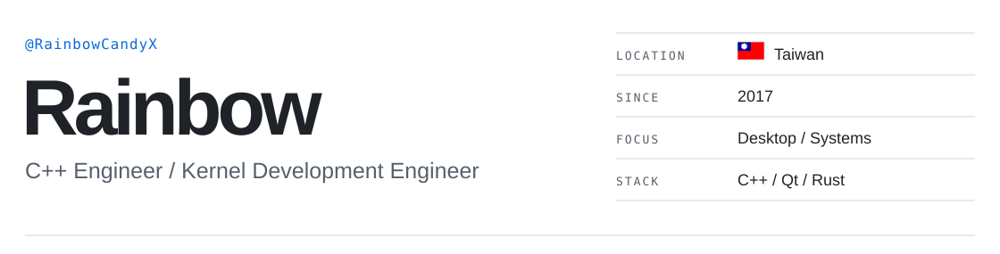

  

  

  <a href="#about">About</a> · <a href="#projects">Projects</a> · <a href="#stack">Stack</a>

---

## About

I build polished desktop software and reusable UI components with **C / C++, Qt, and Rust**. My systems work spans Windows drivers, Intel VT-x, EPT, and nested virtualization.

I also research EPT-based page hiding, debugger-process hiding, hardware ID spoofing, and virtualization-detection evasion.

---

## Projects

| Project | Focus | Tech |
| :--- | :--- | :--- |
| **[ElaWidgetTools](https://github.com/RainbowCandyX/ElaWidgetTools)** | A Fluent UI-inspired Qt Widgets library with additional components and support for Qt 6.10+ and macOS. | C++ / Qt 6 |
| **[HyperV-Manager](https://github.com/RainbowCandyX/HyperV-Manager)** | A desktop interface for managing Hyper-V virtual machines, virtual switches, and GPU partitions. | C++ / Qt 6 / PowerShell |
| **Undisclosed Project** | A Windows x64 kernel virtualization framework with nested virtualization, EPT hooks, page and debugger-process hiding, hardware ID spoofing, virtualization-detection evasion, and a Qt 6 graphical debugger. | C / MASM / WDK / Qt 6 |
| **Undisclosed ARK Project** | A Windows ARK toolkit with process and driver views, kernel callback and WFP inspection, kernel disassembly, and Lua scripting, paired with x64 / ARM64 driver projects. | C++ / WDK / Lua |
| **[qt-element-ui](https://github.com/RainbowCandyX/qt-element-ui)** | Element Plus-inspired controls for Qt desktop apps, covering forms, data display, and navigation. | C++ / Qt 6 |
| **[sserver-status](https://github.com/RainbowCandyX/sserver-status)** | A server-connectivity dashboard with live updates and single-binary deployment. | Rust / SQLite / SSE |
| **[Navicat_Patch](https://github.com/RainbowCandyX/Navicat_Patch)** | A Navicat activation patch utility. | Python / C |

ElaWidgetTools is independently developed from <a href="https://github.com/Liniyous/ElaWidgetTools">Liniyous/ElaWidgetTools</a>. See the project README for attribution and details.

---

## Stack

`C` `C++` `C#` `Rust` `MASM` `Qt 6` `Qt Widgets` `Intel VT-x` `EPT` 
`Lua` `CMake` `MSVC` `WDK` `WinDbg` `Git` `PowerShell` 
`MySQL` `PostgreSQL` `SQLite`

  

